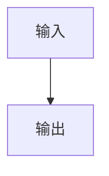

# Troverld 的博客

Hugo + GitHub Pages，原生 CSS，无主题依赖、CSS 框架或动画。首页不加载 JavaScript；文章按内容加载 MathJax / Mermaid；Giscus 点击后才请求。

## 本地预览

安装 [Hugo](https://gohugo.io/installation/) **0.169.0**（与 CI 一致，标准版即可）和 [uv](https://docs.astral.sh/uv/getting-started/installation/)，然后在仓库目录运行：

```sh
hugo server --bind 127.0.0.1
```

访问终端给出的地址，通常是 `http://localhost:1313/`。生产构建：

```sh
hugo --gc --minify
```

输出在 `public/`，不纳入 Git。示例文章已从根目录 `MoE.txt` 原样复制到 `content/posts/MoE.txt`；后续编辑发布目录中的副本即可。

## 发文章

将 UTF-8 编码的 `.md` 或 `.txt` 放到 `content/posts/`，无需 Frontmatter，无需预处理。支持子目录；避免同目录存在同名不同后缀文章，因为它们会对应相同 URL。`index.md` / `_index.md` 是 Hugo 保留的目录页名称。

文章 `content/posts/MoE.txt` 的地址是 `/posts/moe/`。重命名或移动文章会改变地址，也会改变 Giscus 评论归属。

## 管理双层元数据

```sh
uv run admin.py
```

`uv` 使用 `.python-version` 指定的 Python 3.12，脚本采用标准库，无第三方 Python 依赖。浏览器自动打开本地图形化表格。若没有自动打开，可复制终端给出的完整地址；关闭脚本用 Ctrl+C。也可用 `uv run admin.py --no-browser --port 8766` 指定端口。关联 Python 的系统也可直接运行脚本。

每行填写公开标题、公开简介、真实标题、真实简介和创建时间，点击“保存”写入 `data/metadata.json`。创建时间可手动填写，也可点击“当前时间”读取运行 `admin.py` 的电脑的本地系统时间，精确到分钟；点击按钮后仍需保存。保存采用临时文件替换，并阻止多个窗口互相覆盖。表格不删除已移走文章的历史记录；重命名文章后需手动迁移对应键。

文件以相对于 `content/posts/` 的路径（包含扩展名、区分大小写）作为键，例如：

```json
{
  "MoE.txt": {
    "public_title": "MoE 学习笔记",
    "public_description": "关于混合专家模型的一些笔记。",
    "real_title": "MoE 理论整理",
    "real_description": "框架、路由、负载均衡与训练技巧。",
    "created_at": "2026-11-07 09:05"
  }
}
```

| 用途 | 未填写时的回退 |
| --- | --- |
| 目录标题 | 公开标题 → 内部标题 → 文件名（不含后缀） |
| 目录简介、meta description | 公开简介 → 内部简介 → 空文本 |
| 网页 title（标签页名称） | 内部标题 → 文件名（不含后缀） |
| 正文页顶部真实标题 | 正文第一个一级标题，再回退到文件名 |
| 正文页顶部真实简介 | 公开简介，再回退到空文本 |
| 发表时刻 | `created_at`，缺失或无效时显示“未知” |

元数据文件缺失、条目缺失、字段留空或字段类型错误时均可构建。`created_at` 使用 `YYYY-MM-DD HH:MM`（24 小时制、本地墙上时间，不作时区转换）；现有文章已按博客园原帖发表时间填写。手动编辑时仍需保持合法 JSON 语法。

首页和文章目录将缺失、留空或无效创建时间的文章排在最前，右侧显示“未知”；其余按创建时间从新到旧排列，右侧显示精确到分钟的发表时刻。同一分钟内按 URL 倒序固定顺序。旧的 `date` 字段和 Frontmatter 日期不参与排序或发表时刻回退。

文章页面最底部提供“前篇”和“后篇”导航，与目录共用排序：前篇指向列表中下一篇（较早），后篇指向列表中上一篇（较新）；没有相邻文章时显示“无”。时间未知的文章也按目录位置参与导航。

目录按标题、简介各自独立回退；目录和正文中非空的简介均以“摘要：”开头。metadata.json 不会复制到发布目录；内部元数据可用于公开页面展示，双层元数据不提供访问控制。

## Markdown、公式和流程图

支持表格、任务清单、删除线、`CV^2^` 形式的正文上标、围栏代码块和原生 HTML。HTML 按可信作者内容直接输出。

支持 GitHub 提示块：`NOTE`、`TIP`、`IMPORTANT`、`WARNING`、`CAUTION`。使用原生 Markdown 引用语法，无需短代码或 JavaScript：

```markdown
> [!TIP]
> 这里填写提示内容，可包含列表、链接、代码和公式。
```

提示块的标题与左边框依类型使用蓝（Note）、绿（Tip）、紫（Important）、橙（Warning）、红（Caution）。普通引用、代码块中的示例及未知标记不会变成提示块。

数学公式支持 `$…$`、`$$…$$`、`\(…\)` 和 `\[…\]`。Goldmark passthrough 保护公式原文，MathJax 3.2.2 的 `tex-svg-full` 引擎在浏览器输出 SVG（与核验的 Typora 1.10.8 一致）。将 `\newcommand` 放在文章开头的数学块中，定义可供该文后续公式使用，包括带参数的宏：

```tex
$$
\newcommand{\cur}[1]{\left\{#1\right\}}
$$

$\cur{x_1,x_2}$
```

已整体接入 Typora 使用的 **101 项 texvc 兼容宏**，包括 `\sube` → `\subseteq`、`\supe` → `\supseteq`、`\R`、`\N`、`\lang`、`\rang` 等，不需要逐个追加别名。兼容表来自 MathJax 的开源扩展，并已与 Typora 1.10.8 官方安装包的全部内置宏逐项核对一致，来源及许可见 [THIRD_PARTY_NOTICES.md](THIRD_PARTY_NOTICES.md)。文章中的 `\newcommand` 仍可定义或覆盖宏。

同时启用 `textmacros`，保留 MathJax 的扩展自动加载能力（例如化学式 `\ce` 和删除线 `\cancel`）。行间公式中的顶层 `\\` 和 `\newline` 会按 Typora 的“Apply Line Break at \\”机制交给 `\displaylines` 渲染。已有的 `aligned`、矩阵、`cases`、显式 `\displaylines` 及宏定义保持自身的分行和作用域语义。此兼容行为默认启用，文章不需要改写。

行内公式采用 MathJax 原生基线排版，随段落正常换行，不使用单独的滚动容器；超出整段宽度的公式按比例适配。行间公式超宽时仍可整体横向滚动。

Typora 的可选 physics、XY-pic 和自动编号不在默认对齐范围内。

Mermaid 使用 `mermaid` 围栏代码块，渲染为中性配色 SVG。图表保持原始字号；宽图可在图内横向滚动，也可用键盘聚焦后滚动，避免在手机上被压成不可读的小字。示例：

````markdown

````

MathJax 和 Mermaid 的固定版本运行文件随站点部署到 `static/vendor/`，仅在需要的文章页加载，不依赖外部 CDN。页面提前预加载对应入口，MathJax 使用整篇文章共享的 SVG 字形缓存，减少重复路径。依赖加载失败时保留源码；单张图解析失败不会阻止其他图渲染。

这次本机冷加载对比中，MoE 的公式完成时间从约 3.3 秒降为 0.35 秒，流程图从约 4.9 秒降为 0.63 秒，外部渲染依赖请求从 27 个降为零。该结果包含移除 CDN 等待的收益，实际线上速度取决于网络、缓存与设备。博客仍可直接用 Hugo 构建，CI 不需要 npm 安装或打包。

依赖文件已纳入版本控制；只有维护依赖时才需执行以下命令（不会修改文章）：

```sh
npm install --prefix /tmp/blog-vendor --ignore-scripts mathjax@3.2.2 mermaid@11.12.0
node scripts/vendor-libraries.mjs /tmp/blog-vendor/node_modules
```

该脚本校验版本、复制运行文件及许可证，不复制 source maps。升级依赖时还需同步修改脚本、页面预加载路径与加载器路径，并重新运行浏览器回归。

支持目标是常用 Typora Markdown、HTML、Mermaid 和数学语法；不同 Typora 版本、可选扩展与用户设置仍可能产生差异，MathJax 不支持的完整 LaTeX 包也不保证一致。不会执行 LaTeX 外部程序或加载任意 TeX 宏包。

## Giscus 评论

在 GitHub 仓库启用 Discussions 并安装 [Giscus](https://giscus.app/zh-CN)，从配置页取得仓库 ID 和分类 ID，填写 `hugo.toml` 的 `[params.giscus]`：

```toml
repo = 'Troverld/Troverld.github.io'
repoId = '配置页提供的 R_...'
category = 'Announcements'
categoryId = '配置页提供的 DIC_...'
```

配置完整后，文章页显示“加载评论”纯文本按钮。点击后加载，按 URL pathname 映射，使用 `noborder_light`。配置为空时不显示评论入口，也不会访问 Giscus。

## 部署到 GitHub Pages

1. 推送仓库到 GitHub，并在 Settings → Pages → Build and deployment 中将 Source 设置为 **GitHub Actions**。
2. 按需修改 `hugo.toml` 的站点标题、描述和 `baseURL`。工作流部署时会使用 Pages 返回的地址，也支持项目子路径。
3. 推送到 `main` 或 `master`，或手动触发 Deploy Hugo to Pages 工作流。

工作流下载并校验固定版本 Hugo，运行回归检查，构建后通过官方 Pages Actions 上传和部署静态文件。无需 Python 预处理文章，也不会上传本地管理脚本或元数据源文件。

## 验证

```sh
uv run python -m unittest discover -s tests -v
```

测试覆盖纯 `.txt` / `.md`、元数据优先级与回退、创建时间排序及前后篇导航、公式原文保护、原生 HTML、Mermaid 标记、子路径链接、Giscus 按需加载，以及管理脚本的保存、时间验证、当前系统时间与冲突检测。没有安装 Hugo 时会跳过 Hugo 测试，也可通过 `HUGO_BIN` 指定可执行文件。

数学引擎的浏览器回归（需启动 `hugo server`，测试默认访问 1313 端口）：

```sh
npm install --prefix /tmp/blog-math-test playwright@1.65.0
/tmp/blog-math-test/node_modules/.bin/playwright install chromium
NODE_PATH=/tmp/blog-math-test/node_modules node tests/math-browser.cjs
```

该测试阻断外部 HTTPS 请求，并验证 MoE 的 228 个公式、全部 101 项兼容宏及其展开结果、带参数的自定义宏、扩展自动加载、SVG 输出、Mermaid、行间换行、矩阵和宏作用域、行内无滚动条与手机布局。测试依赖只安装到临时目录，不参与博客构建或 CI。
